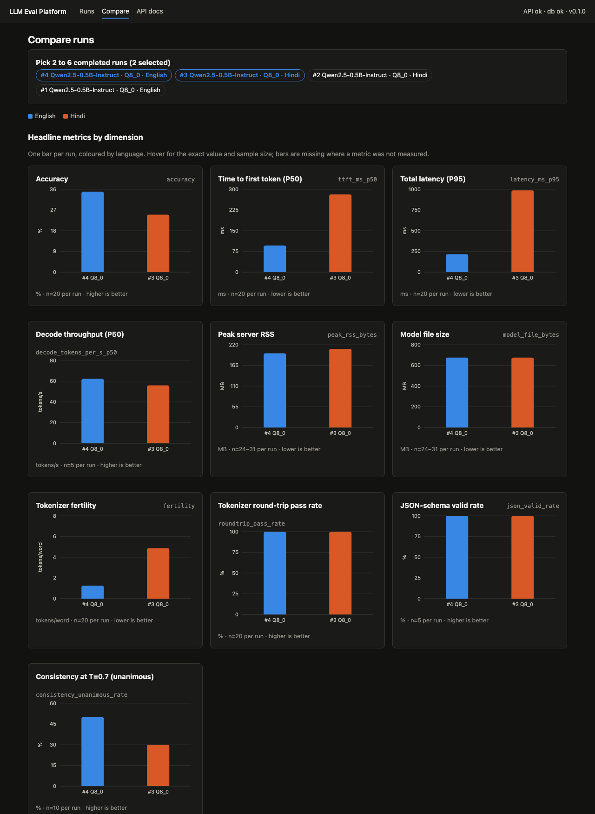
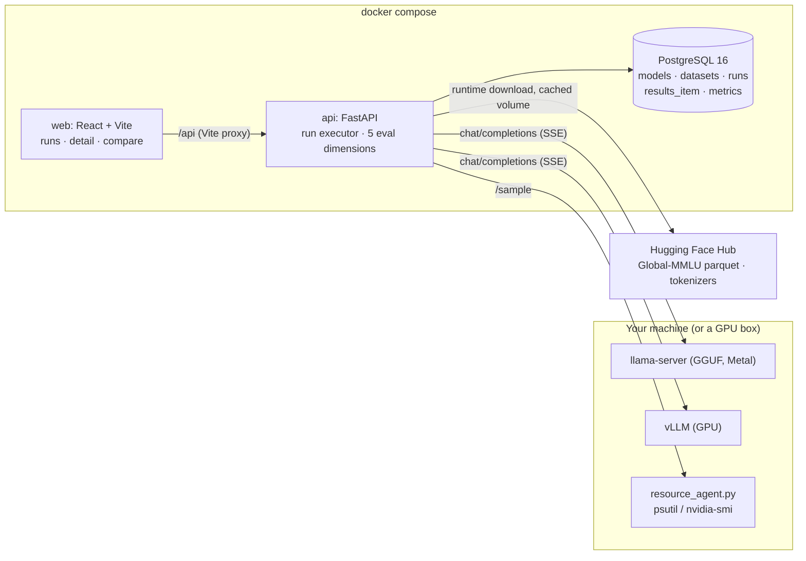

# LLM Inference & Evaluation Platform

[](https://github.com/gauraangst5514/llm-evaluation-platform/actions/workflows/ci.yml)

Serves open LLMs behind OpenAI-compatible endpoints (llama.cpp `llama-server` locally on a Mac, vLLM on a GPU box), runs a fixed, seeded evaluation suite against them, scores each model on **five dimensions**, stores everything in PostgreSQL and compares runs in a React dashboard.

It is also the harness for a planned study: **does GGUF quantization (Q8_0 → Q3_K_M) hurt Indic languages more than English, and does the accuracy drop track tokenizer fertility?** See [PROJECT_SPEC.md](PROJECT_SPEC.md) for the full specification and milestones.

**Status: Milestone 5 of 6.** The platform is complete and tested; the quantization pilot (M6) has not been run yet. The only numbers in this README come from smoke-test runs of a 0.5B model and are labelled as such.



## Architecture



Model servers are deliberately **not** bundled. They run wherever the hardware is and are registered by URL.

## Quick start

```bash
cp .env.example .env            # defaults work for local Docker
docker compose up --build
```

| Service | URL |
|---|---|
| Dashboard | http://localhost:5173 |
| API docs (Swagger) | http://localhost:8000/docs |
| Health | http://localhost:8000/health |
| Postgres | localhost:5432, user/db `llmeval` |

On start the API applies Alembic migrations and upserts the dataset registry, so `GET /datasets` is populated immediately.

### Start a model server

**macOS, Apple Silicon (llama.cpp)** — full notes in [scripts/start_llama_server.md](scripts/start_llama_server.md):

```bash
brew install llama.cpp
llama-server -hf Qwen/Qwen2.5-7B-Instruct-GGUF:Q4_K_M --port 8080 -c 8192 -np 2
# optional, for the resources dimension:
uv run --with psutil scripts/resource_agent.py --process llama-server --port 9108
```

Keep each slot's context (`-c / -np`) at 4096 or more: a Global-MMLU law question that is 363 tokens in English is 1512 tokens in Hindi.

**Kaggle / Colab / Modal (vLLM)** — see [scripts/start_vllm_server.md](scripts/start_vllm_server.md). vLLM serves the same OpenAI-compatible API; expose it through a tunnel and register the tunnel URL.

### Register it and run

From the dashboard (Runs page → Register, then New run), or:

```bash
curl -X POST localhost:8000/models -H 'content-type: application/json' -d '{
  "name": "Qwen2.5-7B-Instruct", "hf_repo": "Qwen/Qwen2.5-7B-Instruct",
  "backend": "llama_cpp", "endpoint_url": "http://host.docker.internal:8080",
  "quantization": "Q4_K_M", "params_b": 7.6,
  "resource_agent_url": "http://host.docker.internal:9108"}'

python scripts/run_pilot.py --model-id 1 --dataset global_mmlu_en --dataset global_mmlu_hi --n-items 200
python scripts/export_results.py --run 1 --name pilot_qwen2.5-7b_q4_k_m_en   # -> results/*.csv
```

One `models` row per quantization (same `name`, different `quantization`); the dashboard compares rows.

## How a run works

1. `POST /runs` stores the run as `pending` and starts an asyncio task in the API process.
2. The dataset's fixed subset is materialised once: a seeded sample of `sample_id`s, chosen from the English file and shared by Hindi and Bengali, stored on the dataset row. Every run with the same seed sees the same items in the same order; `n_items` takes a prefix.
3. Each item is sent as a chat completion with `temperature=0`, `stream=true` and `stream_options.include_usage`. TTFT is measured at the first content delta; token counts come from the server's usage block or are stored as null.
4. Bounded concurrency, per-request timeout, one retry on transient failures (timeouts, connection errors, 5xx, 429). 4xx errors such as context overflow are recorded on the item and not retried.
5. Answers are parsed strictly (a single option letter, optionally after "Answer:"). Unparseable replies count as wrong and are reported; failed requests are not scored. More than 10% failed requests marks the run `failed`, never "low accuracy".
6. The requested dimensions run after the item pass and store their metrics. Runs can be cancelled; runs interrupted by an API restart are marked `failed` on startup.

## The five dimensions

Each is a class in `backend/app/evals/` implementing `Eval.run(ctx) -> list[Metric]`. Anything that cannot be measured is stored as `null` with the reason in `extra_json`. Nothing is estimated.

| Dimension | What is measured | How |
|---|---|---|
| accuracy | accuracy with 95% Wilson CI, unparseable rate, request-error rate, per-category and per-subject breakdown, answer-letter distribution (position bias) | the greedy MCQ pass |
| latency | TTFT and total latency P50/P95 at the run's concurrency; prefill tokens/s; decode tokens/s from 5 sequential 128-token generation probes | streamed responses, server-reported token counts |
| resources | peak RSS of the server process, peak GPU memory, model file size (split GGUFs summed) | host-side `scripts/resource_agent.py`; null without it |
| tokenizer | fertility (tokens per whitespace word), tokens per character, decode(encode(x)) == x pass rate | the model's own `AutoTokenizer` on the exact question+option text of the run |
| reliability | MCQ valid-format rate; JSON-schema valid rate on 5 probes; consistency over 3 repeats at temperature 0.7 (unanimous rate and mean pairwise agreement) | extra requests after the accuracy pass |

## API

`GET /health` · `POST/GET/PATCH/DELETE /models` · `GET /datasets` · `POST /runs` · `GET /runs` · `GET /runs/{id}` · `GET /runs/{id}/items?only_failed=` · `POST /runs/{id}/cancel` · `DELETE /runs/{id}` · `GET /compare?run_ids=1,2` · `GET /export/{id}.csv?kind=items|metrics`

## Datasets and licences

Registered in `backend/app/datasets/registry.py`. Nothing is committed to the repo; loaders fetch from the Hub at runtime into a Docker volume.

| Dataset | Languages | Split | Subset | Licence | Checked |
|---|---|---|---|---|---|
| [Global-MMLU](https://huggingface.co/datasets/CohereLabs/Global-MMLU) | en, hi, bn (same questions, shared `sample_id`) | test | 200 items, seed 42 | Apache-2.0 | 2026-11-12, Hugging Face dataset card |

The parallel subset doubles as the tokenizer-efficiency sample, so fertility is measured on the exact text the model is scored on. Not registered: MILU (CC-BY-4.0) and FLORES-200 (CC-BY-SA-4.0) are gated on the Hub and their fields could not be verified without a token; IndicXNLI states no licence on its card.

## Results

The table below is generated by `python scripts/results_table.py results/*_metrics.csv` from CSVs the platform exported. **These are smoke-test runs of a 0.5B model with n=20**, used to prove the pipeline end to end. They are not the pilot and support no conclusion about quantization.

| Model | Quant | Lang | Run | Accuracy | TTFT p50 | Decode tok/s p50 | Fertility (tok/word) | JSON valid | Consistency@0.7 | Peak RSS |
|---|---|---|---|---|---|---|---|---|---|---|
| Qwen2.5-0.5B-Instruct | Q8_0 | en | 4 | 35.0% (18–57%), n=20 | 96 ms | 62.4 | 1.25 | 100% (n=5) | 50% (n=10) | 197 MB |
| Qwen2.5-0.5B-Instruct | Q8_0 | hi | 3 | 25.0% (11–47%), n=20 | 282 ms | 56.0 | 4.87 | 100% (n=5) | 30% (n=10) | 209 MB |

Setup: MacBook Air M2 16 GB, llama-server 0.9.0 (Metal), `-c 8192 -np 2`, run concurrency 2, same 20 questions in both languages.

The one effect already visible at this size is tokenizer fertility: the Qwen2.5 tokenizer needs 3.9× more tokens per word for Hindi than for English on identical questions, which is why Hindi TTFT is about 3× higher. The pilot (M6) will test whether accuracy loss under quantization tracks this.

## Limitations

- **Sample sizes.** 200 items per language is the registered maximum; the 95% interval on an accuracy near 30% is about ±6 pp at n=200 and ±20 pp at n=20. Differences smaller than that are noise and the dashboard prints the interval next to every accuracy.
- **Single runs.** Greedy decoding is reproducible (runs 1 and 4 gave identical answers item by item), but latency and resource numbers are from one run on a laptop that was doing other things. Treat them as indicative.
- **English instruction prompt.** The question and options are in the target language; the instruction ("answer with only the letter") is English for every language. This is a confound for the Indic results and will be stated in the pilot write-up.
- **Strict parsing.** A model that answers correctly in prose is scored wrong. The unparseable rate is reported so this is visible.
- **Resource numbers on macOS.** llama.cpp uses mmap and Metal unified memory, so process RSS undercounts the memory the model actually pins. `peak_rss_bytes` is a lower bound there; `model_file_bytes` is exact. On NVIDIA hosts the agent reads `nvidia-smi`.
- **Decode throughput** comes from 5 open-ended probes at concurrency 1, not from the MCQ answers (one-letter replies are too short to time).
- **Not measured yet:** anything on GPU, any model larger than 0.5B, Bengali (registered, not yet run), MILU/FLORES.

## Development

```bash
# backend (tests need Postgres; the compose db works, tests use a separate llmeval_test database)
cd backend
uv venv --python 3.11 .venv && uv pip install --python .venv/bin/python -e ".[dev]"
.venv/bin/pytest -q && .venv/bin/ruff check . ../scripts
.venv/bin/alembic revision --autogenerate -m "describe change"   # after editing app/db/models.py

# frontend
cd frontend
npm install && npm run dev        # proxies /api to http://localhost:8000
npm run lint && npm run build
```

CI (GitHub Actions) runs ruff, the backend tests against a Postgres service, and the frontend type-check and build on every push.

## Repository layout

```
backend/app/
  api/          health, models, datasets, runs, compare+export routers
  backends/     OpenAI-compatible streaming client (TTFT, usage, error classes)
  datasets/     registry (licences, subset sizes) and loader (seeded, parallel subsets)
  evals/        mcq prompting/parsing + the five dimension classes
  services/     run executor
  db/           SQLAlchemy models, session
backend/alembic/  migrations
backend/tests/    71 tests incl. an in-process mock OpenAI server
frontend/src/     pages (runs, run detail, compare), charts, API client
scripts/          start_llama_server.md, start_vllm_server.md, resource_agent.py,
                  run_pilot.py, export_results.py, results_table.py
results/          CSV exports of real runs (committed on purpose)
docs/             screenshots, pilot write-up (M6)
```
