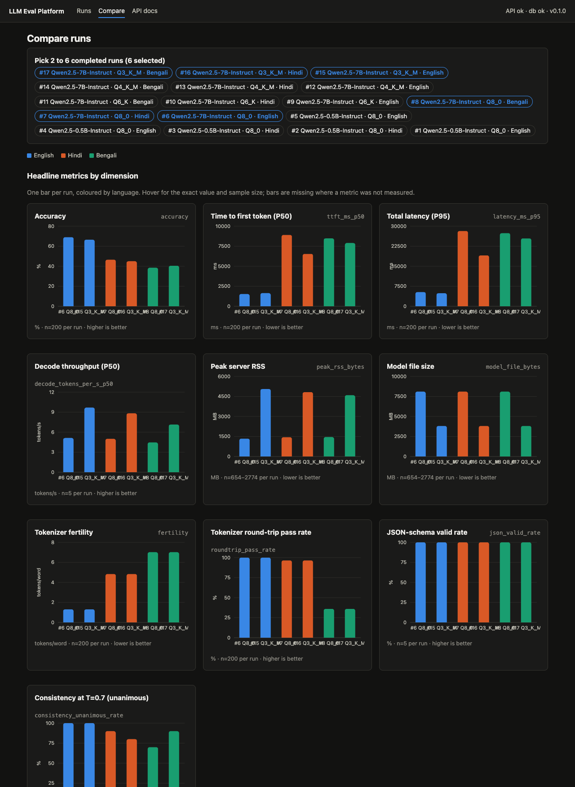

# Pilot: does GGUF quantization hurt Indic languages more than English?

**Model:** Qwen2.5-7B-Instruct, official GGUF files (`Qwen/Qwen2.5-7B-Instruct-GGUF`) at Q8_0, Q6_K, Q4_K_M and Q3_K_M.
**Data:** Global-MMLU test split, the same 200 questions (seed 42, shared `sample_id`) in English, Hindi and Bengali.
**Setup:** MacBook Air M2 16 GB, llama-server 0.9.0 (Metal), `-c 8192 -np 2`, run concurrency 2, greedy decoding (temperature 0). One quantization was loaded at a time and the languages ran one after another.
**Runs:** 6–17 in the platform, 12 cells × 200 items, 0 request errors, 0 unparseable answers.
**Data files:** `results/pilot_qwen2.5-7b.csv` (all metrics, long format) and `results/pilot_qwen2.5-7b_<quant>_<lang>_{metrics,items}.csv`.
**Analysis:** `python scripts/pilot_analysis.py results/pilot_qwen2.5-7b` prints every table below.

## Finding

**At n=200 we found no measurable accuracy loss from quantization, down to Q3_K_M, in any of the three languages. So the data cannot show Indic languages being hurt more than English, or the drop tracking tokenizer fertility.**

Every quantized model answered the same items as Q8_0, so the drop was measured on paired, per-item correctness. All nine paired differences fall between −2 and +2.5 percentage points, and every 95% interval includes zero. The intervals rule out a drop larger than about 7 pp in any cell. Smaller effects are not ruled out.

| Quant | English | Hindi | Bengali |
|---|---|---|---|
| Q8_0 (accuracy) | 69.0% (62–75) | 46.5% (40–53) | 38.5% (32–45) |
| Q6_K drop vs Q8_0 | +0.0 pp | −0.5 pp (−2 to +1) | −1.0 pp (−4 to +2) |
| Q4_K_M drop | −1.0 pp (−5 to +3) | +2.0 pp (−2 to +6) | −0.5 pp (−4 to +3) |
| Q3_K_M drop | +2.5 pp (−2 to +7) | +1.5 pp (−4 to +7) | −2.0 pp (−7 to +3) |

Positive means the quantized model is worse. Accuracy cells show 95% Wilson intervals; drop cells show 95% intervals on the paired difference.

The largest point drop is in **English** (Q3_K_M, +2.5 pp). Bengali at Q3_K_M scored slightly *higher* than at Q8_0. Fertility is 1.31 tokens per word for English, 4.83 for Hindi and 7.02 for Bengali. The mean drops (+0.5, +1.0, −1.2 pp) do not rise with fertility. With no detectable drop, there is nothing for a correlation to work with.

## What the data does show

1. **The language gap is large, and quantization does not cause it.** At Q8_0, English scores 69%, Hindi 46.5% and Bengali 38.5% on identical questions. The intervals do not overlap, and the gap is the same at every quantization level.
2. **Tokenization cost.** On the same text, Hindi takes 3.7× and Bengali 5.4× as many tokens per word as English. Prompt-processing time grows to match: median time to first token is about 1–2.6 s for English and 6–10 s for Hindi and Bengali.
3. **Answers shift more in Indic languages, but the net effect is zero.** Q8_0 and Q3_K_M disagree on 17 English items, 31 Hindi items and 30 Bengali items. Across all four quantizations, correctness is identical on 176/200 English, 160/200 Hindi and 156/200 Bengali items. Quantization moves Indic answers around more, but gains and losses roughly cancel. Two cautions: items near chance flip more easily anyway, and this is an observation from one model, not a tested claim.
4. **Q6_K matched Q8_0 on every English item** (no discordant pairs), and differed on only 3 Hindi and 10 Bengali items.
5. **The model rarely answers "D" in Indic languages.** D is the gold answer for 52 of 200 items. The model chose D 34–41 times in English and only 24–30 times in Hindi and Bengali, at every quantization. This letter bias is one plausible contributor to the Indic gap. It was not investigated further.

Dashboard view of Q8_0 against Q3_K_M (runs 6–8 and 15–17), from `/compare?runs=6,15,7,16,8,17`:

## Caveats

- **Sample size.** n=200 per cell, so a single accuracy has a 95% interval about ±6–7 pp wide. Pairing narrows the interval on differences, but effects under about 3–5 pp are still invisible. Consistency at temperature 0.7 uses only 10 items × 3 repeats, and JSON validity only 5 probes. Those figures are in the data files but too small to compare.
- **One model, one seed, one item subset.** Other model families, or quantizations below Q3_K_M (Q2_K), may behave differently.
- **English instruction.** The question and options are in the target language, but the instruction ("answer with only the letter") is in English for every language. This confounds the Indic accuracy (finding 1) and possibly the D bias (finding 5).
- **Strict parsing.** Only a bare letter counts. The unparseable rate was 0% in every cell, so this did not affect these results.
- **Latency was not controlled.** Runs 6–10 (Q8_0 and Q6_K English/Hindi) ran on 2026-11-12 and runs 11–17 on 2026-11-14, on a laptop also in use for other work. Latency does not decrease steadily with quantization level (Q6_K English median time to first token is 2.6 s, against 1.5 s for Q8_0). Read latency as showing the effect of language and tokenization, not of quantization. In run 17 (Q3_K_M Bengali), the laptop went to sleep on battery after all 200 accuracy items had finished. The decode-throughput measurements that ran afterwards (7.1 tokens/s) may be lower because of it. Accuracy and time to first token for that run were measured before the sleep.
- **Memory.** llama.cpp memory-maps the weights and runs on Metal unified memory, so process RSS undercounts. For example, Q8_0 shows 1.3 GB peak RSS for an 8.1 GB file. Model file size (8.10 / 6.25 / 4.68 / 3.81 GB) is the reliable memory figure here.
- **Bengali tokenizer roundtrip (36%).** This is not information loss. Every failure we checked (154 of 154 on a 300-item sample) decodes back to the NFC-normalized form of the input. Global-MMLU's Bengali text is not stored in NFC, and the Qwen tokenizer normalizes it.

## Full tables (generated)

The output of `scripts/pilot_analysis.py`, unedited:

### Accuracy by quantization and language (95% Wilson CI, n scored items)

| Quant | English | Hindi | Bengali |
|---|---|---|---|
| Q8_0 | 69.0% (62–75%), n=200 | 46.5% (40–53%), n=200 | 38.5% (32–45%), n=200 |
| Q6_K | 69.0% (62–75%), n=200 | 47.0% (40–54%), n=200 | 39.5% (33–46%), n=200 |
| Q4_K_M | 70.0% (63–76%), n=200 | 44.5% (38–51%), n=200 | 39.0% (33–46%), n=200 |
| Q3_K_M | 66.5% (60–73%), n=200 | 45.0% (38–52%), n=200 | 40.5% (34–47%), n=200 |

### Paired accuracy drop versus Q8_0 (percentage points, same items)

Positive = quantized model worse. b/c = items only Q8_0 got right / items only the quantized model got right.

| Quant | English | Hindi | Bengali |
|---|---|---|---|
| Q6_K | +0.0 pp (+0 to +0), b/c=0/0, n=200 | -0.5 pp (-2 to +1), b/c=1/2, n=200 | -1.0 pp (-4 to +2), b/c=4/6, n=200 |
| Q4_K_M | -1.0 pp (-5 to +3), b/c=6/8, n=200 | +2.0 pp (-2 to +6), b/c=11/7, n=200 | -0.5 pp (-4 to +3), b/c=7/8, n=200 |
| Q3_K_M | +2.5 pp (-2 to +7), b/c=11/6, n=200 | +1.5 pp (-4 to +7), b/c=17/14, n=200 | -2.0 pp (-7 to +3), b/c=13/17, n=200 |

### Tokenizer fertility, latency and resources

| Quant | Lang | Fertility | Tok/char | TTFT p50 | Latency p50 | Decode tok/s | Peak RSS | Model file | Unparseable | Req. errors |
|---|---|---|---|---|---|---|---|---|---|---|
| Q8_0 | en | 1.31 | 0.214 | 1530 ms | 1821 ms | 5.1 | 1.34 GB | 8.10 GB | 0.0% | 0.0% |
| Q8_0 | hi | 4.83 | 0.917 | 8909 ms | 9148 ms | 5.0 | 1.44 GB | 8.10 GB | 0.0% | 0.0% |
| Q8_0 | bn | 7.02 | 1.061 | 8478 ms | 8636 ms | 4.5 | 1.46 GB | 8.10 GB | 0.0% | 0.0% |
| Q6_K | en | 1.31 | 0.214 | 2645 ms | 2818 ms | 5.4 | 4.33 GB | 6.25 GB | 0.0% | 0.0% |
| Q6_K | hi | 4.83 | 0.917 | 10180 ms | 10478 ms | 3.9 | 4.03 GB | 6.25 GB | 0.0% | 0.0% |
| Q6_K | bn | 7.02 | 1.061 | 6719 ms | 6945 ms | 8.2 | 6.15 GB | 6.25 GB | 0.0% | 0.0% |
| Q4_K_M | en | 1.31 | 0.214 | 1061 ms | 1626 ms | 8.9 | 5.58 GB | 4.68 GB | 0.0% | 0.0% |
| Q4_K_M | hi | 4.83 | 0.917 | 6383 ms | 6534 ms | 9.1 | 5.27 GB | 4.68 GB | 0.0% | 0.0% |
| Q4_K_M | bn | 7.02 | 1.061 | 7773 ms | 7938 ms | 9.2 | 5.23 GB | 4.68 GB | 0.0% | 0.0% |
| Q3_K_M | en | 1.31 | 0.214 | 1642 ms | 2154 ms | 9.7 | 5.05 GB | 3.81 GB | 0.0% | 0.0% |
| Q3_K_M | hi | 4.83 | 0.917 | 6538 ms | 6678 ms | 8.8 | 4.82 GB | 3.81 GB | 0.0% | 0.0% |
| Q3_K_M | bn | 7.02 | 1.061 | 7901 ms | 8074 ms | 7.1 | 4.59 GB | 3.81 GB | 0.0% | 0.0% |

### Fertility versus paired drop, per language

| Language | Fertility (Q8_0) | Mean drop | Largest drop |
|---|---|---|---|
| English | 1.31 | +0.5 pp | +2.5 pp |
| Hindi | 4.83 | +1.0 pp | +2.0 pp |
| Bengali | 7.02 | -1.2 pp | -0.5 pp |

### Reliability and answer-letter distribution

| Quant | Lang | JSON valid | Unanimous @0.7 | Pairwise @0.7 | Answer letters |
|---|---|---|---|---|---|
| Q8_0 | en | 100.0% | 100.0% | 100.0% | A:54, B:55, C:50, D:41 |
| Q8_0 | hi | 100.0% | 90.0% | 93.3% | A:56, B:56, C:58, D:30 |
| Q8_0 | bn | 100.0% | 70.0% | 76.7% | A:51, B:61, C:60, D:28 |
| Q6_K | en | 100.0% | 100.0% | 100.0% | A:54, B:55, C:50, D:41 |
| Q6_K | hi | 100.0% | 90.0% | 93.3% | A:55, B:55, C:60, D:30 |
| Q6_K | bn | 100.0% | 60.0% | 70.0% | A:51, B:59, C:60, D:30 |
| Q4_K_M | en | 100.0% | 100.0% | 100.0% | A:49, B:59, C:52, D:40 |
| Q4_K_M | hi | 100.0% | 70.0% | 80.0% | A:53, B:58, C:63, D:26 |
| Q4_K_M | bn | 100.0% | 80.0% | 86.7% | A:45, B:59, C:68, D:28 |
| Q3_K_M | en | 100.0% | 100.0% | 100.0% | A:51, B:65, C:50, D:34 |
| Q3_K_M | hi | 100.0% | 80.0% | 86.7% | A:54, B:65, C:56, D:25 |
| Q3_K_M | bn | 100.0% | 90.0% | 93.3% | A:51, B:61, C:64, D:24 |

